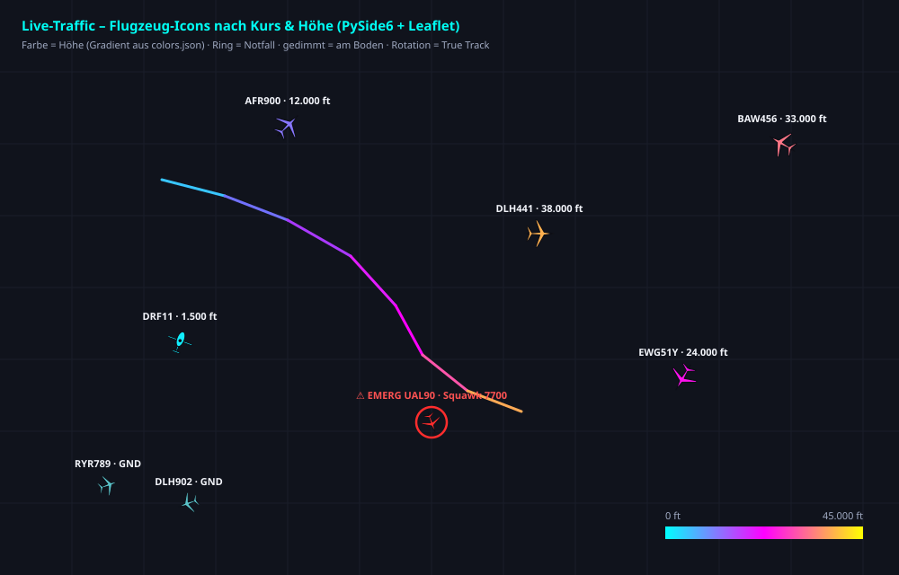

# MSFS Live Traffic Utility

MSFS Live Traffic Utility is an open-source Python desktop application that displays real-world ADS-B traffic on an interactive map and can inject matching AI traffic into Microsoft Flight Simulator using SimConnect.

Since v2 the GUI is built with **PySide6 (Qt)**: a modern dark-themed desktop window with a hardware-accelerated map view (QtWebEngine + Leaflet), rotated SVG aircraft icons, live aircraft table and detail panel.

The goal of this project is to provide a lightweight and transparent alternative for viewing real-world air traffic and optionally using compatible AI traffic in Microsoft Flight Simulator. Project-authored code is licensed under the GNU Affero General Public License v3.0 only (AGPL-3.0-only); see [`LICENSE`](LICENSE). Third-party components and data remain subject to their own licenses and terms.

## Features

- Real-time ADS-B aircraft tracking
- Modern Qt desktop GUI (PySide6) with a dark theme and a tabbed Settings dialog
  (local fallback key, map, appearance, filters/network and MSFS options)
- Interactive map (QtWebEngine + Leaflet, switchable OpenStreetMap, dark CARTO,
  OpenTopoMap or an attributed custom tile server)
- **Proper aircraft icons**: rotated top-view SVG silhouettes (airliner & helicopter),
  colored by altitude, dimmed when on ground, red alert ring for emergencies
  (see `docs/gui_preview.svg`)
- **Aircraft table** with live updates; click a row or an icon on the map to select a flight
- **Emergency highlighting** (Squawk 7500/7600/7700 or ADS-B emergency state)
- **Route display** (adsbdb): great-circle line plus origin/destination markers and route details in the info panel
- Search and track individual flights, or run in live mode showing all traffic
- Detailed aircraft information panel (airline name, category, route, nav data…)
- Altitude-based color gradients (configurable in `colors.json`)
- Flight trail visualization with altitude gradient (incremental, capped length)
- **Shared one-hour flight history**: the proxy keeps a sampled path per ICAO hex from
  collector/relay pushes and fresh regional traffic queries. Tracks resolve by hex or
  callsign, so selecting an aircraft can preload its recent trail asynchronously
- Filters: minimum altitude, hide ground traffic, labels on/off, follow mode
- **Search & filters**: search by callsign/hex/type/registration (Enter jumps to the
  first match), plus live airline and ICAO-type filters
- **Trails for all aircraft** (toggle) in addition to the selected-flight trail
- **Emergency alerts**: toast + beep when a squawk 7500/7600/7700 appears in the
  visible map area (no duplicate alarms)
- **TCAS mode with MSFS**: your own aircraft (SimConnect position) is drawn on the map,
  the view follows you, and the info panel shows clock position, distance (km/nm),
  altitude difference and climb/descent trend of the selected traffic
- **CSV export** of the current traffic snapshot (semicolon-delimited, Excel-friendly)
- **Settings persistence** (QSettings): window geometry, map center/zoom, style,
  appearance, source/network, MSFS and filter preferences are stored per user and
  restored on the next start; the PlaneTrack API key stays out of `colors.json` and releases
- **Always-on live map**: starts in all-aircraft mode automatically and remains
  available when MSFS/SimConnect is not running. A running MSFS/SimConnect connection
  is needed for player-position follow/TCAS and optional AI injection; if MSFS starts
  after the app, the connection probe retries automatically.
- **Timestamped diagnostics**: each launch creates a log in `logs/` (with a writable
  user-data fallback) containing timestamped output, UI actions, settings changes,
  source requests/status changes, and MSFS/mesh events
- **Failover chain**: proxy → **Ersatz-Proxy (peer mesh)** → automatic direct fallback →
  last cache. Regional sources run in order adsb.lol → adsb.fi → OpenSky → optional
  PlaneTrack.ai. PlaneTrack is the fourth ordinary source, not a separately preferred
  provider in Settings; the proxy collector uses its own local credential file.
- **PlaneTrack.ai**: optional fourth source in the proxy collector chain; its key is
  collector-only and is never sent to clients or included in public status. A separate,
  per-user key can optionally enable the client's final direct fallback when proxy and
  mesh are unavailable. Requests are spaced by 2.5 seconds and capped at 250 NM.
- **Peer mesh via web relay – zero router/firewall config**: all mesh traffic is routed
  through the proxy web page. When the proxy is down **or returns HTTP 429**, the server
  elects one client *randomly* as Ersatz-Proxy; it pushes its own traffic data to the
  page (`?action=relay_push`) and everyone else pulls it from there
  (`?action=relay_pull`). If the Ersatz fails or is itself rate-limited, the **next**
  one takes over (chained failover) – works across the internet, no ports needed
- **Status LEDs** in the GUI status bar (proxy / adsb.lol / adsb.fi / OpenSky /
  PlaneTrack / Ersatz-Proxy / MSFS: green = ok, orange = 429, red = down, grey = idle) plus the
  current mesh role; the same status is shown as an overlay on the web map
- **Public status page**: upload the proxy as `index.php` and opening the LTU folder
  shows live status right away (also via `?action=statuspage`): who is online, which part
  works and which is down – no token needed
- Zoom shortcuts (`+` / `-`), `Esc` deselects, right-click selects the nearest aircraft
- Automatic aircraft model mapping
- SimConnect integration; **GUI and AI traffic injection run in parallel**
  (toolbar toggle; AI mode starts automatically when a simulator is detected)
- SimConnect is optional – map mode starts even without the SimConnect package
- Experimental AI traffic injection
- Support for FSLTL model matching
- JSON-based theme customization (colors, icon sizes, label/emergency/accent colors)
- Automatic language detection (German / English)
- UI-independent core logic (`traffic_core.py`) – fully testable without Qt



## Architecture

| Module            | Purpose                                                                 |
| ----------------- | ----------------------------------------------------------------------- |
| `main.py`         | Qt view: window, toolbar, table, info panel, QWebEngineView + QWebChannel bridge |
| `settings_dialog.py` | Tabbed PySide6 settings UI; MainWindow applies and persists user preferences |
| `traffic_core.py` | Framework-independent engine: ADS-B polling, filters, selection, trail, route, state snapshots |
| `msfs_ai.py`      | SimConnect stack: EX1/parked spawns, position updates, AI traffic loop (thread) |
| `startup_splash.py` | Animated startup screen and flight-profile indicator                    |
| `aircraft_config.py` | MSFS Community discovery and `aircraft.cfg` title catalog              |
| `gui_web/`        | Map frontend (Leaflet + SVG icons), loaded inside QtWebEngine, vendored Leaflet |
| `model_map.py`    | FSLTL model matching rules (`modelmap.txt`)                              |
| `routes.py`       | adsbdb route lookup + airport proximity helpers                          |
| `proxy/`          | Optionaler Relay-Betrieb: `index.php` (Webspace) + `ltu_collector.cpp` (Server-PC) |

Python → JavaScript communication uses Qt signals (`stateUpdated`, `settingsUpdated`),
JavaScript → Python uses Qt slots on the `bridge` object (`aircraftClicked`,
`mapContextMenu`, `mapMoved`, `uiReady`).

## How It Works

The application retrieves publicly available ADS-B traffic data and displays aircraft positions on a live map. The startup splash appears before the slower WebEngine and traffic modules are imported. Its flight marker advances with real startup stages, including the aircraft.cfg scan, along a steep climb, level segment, and descent.

The app discovers MSFS Community folders from simulator `UserCfg.opt` files. If several installations are found, it asks which one to use; if none is found, it asks the user to browse for the Community or parent Packages folder. The selection is saved in application settings. Aircraft `title` values are indexed from the selected Community folder's `aircraft.cfg` files and used to choose installed models for AI injection. Set `MSFS_COMMUNITY_PATH` to override automatic discovery, or `MSFS_PACKAGES_PATH` to point at a Packages directory. The current FSLTL/VMR title matching is based on legacy `aircraft.cfg` titles; SimConnect EX1 receives the full title with an empty livery field (default livery). MSFS 2024 modular SimObjects must resolve to a valid aircraft preset, and deterministic variant selection needs livery enumeration; that modular-livery resolution is not implemented yet.

When Microsoft Flight Simulator is running, the utility can use SimConnect to spawn matching AI aircraft and update their positions based on real-world traffic data – now in parallel with the map GUI (toggle in the toolbar). At an airport where the player is on the ground, it can also make best-effort attempts to spawn **synthetic, static parked aircraft**; these are local MSFS fillers, not live flights and not shown as real traffic on the map.

The parked filler uses the optional `MSFS_AIRPORT_ICAO` override first, then SimConnect's current-airport SimVars and the existing live-traffic inference. It requests parked aircraft until SimConnect rejects a spawn or the safety cap is reached. SimConnect does not provide a dependable count of all free stands here, so a failed request is not proof that every stand is occupied; the feature is intentionally best-effort, not a guarantee that every airport stand is filled. The default cap is 50 aircraft and can be changed with `MSFS_MAX_PARKED_FILLERS`; the app picks an installed A20N title from `aircraft.cfg` by default, while `MSFS_PARKED_FILLER_MODEL` can override that choice.

When the simulator is not running, the utility automatically runs in map mode and can be used as a standalone traffic viewer.

## Requirements

- Windows 10 / 11 (Linux/macOS for map mode)
- Python 3.10 or newer
- Internet connection
- For AI traffic mode: Microsoft Flight Simulator 2020 or 2024, bundled `SimConnect.dll`, FSLTL base models (recommended)

## Installation

Clone the repository:

```bash
git clone https://github.com/PhW3130/Live-Traffic.git
cd Live-Traffic
```

Install dependencies:

```bash
pip install -r requirements.txt
```

Start the application:

```bash
python main.py
```

## Releases

Windows release ZIPs are published on the [GitHub Releases page](https://github.com/PhW3130/Live-Traffic/releases) when a version tag (`v*`) is pushed. Pull requests validate the Windows build; after a change reaches `main`, the workflow rebuilds the distribution, uploads the generated `rea/` files in size-limited batches to a temporary branch, then updates `main` to the completed package instead of uploading a GitHub Actions artifact. See the [publishing checklist](docs/PUBLISHING-CHECKLIST.md) for the remaining source, runtime-validation, and redistribution-rights requirements.

You can also build a standalone Windows EXE yourself (no Python needed on the target PC):

```bat
build_exe.bat
rem Ergebnis: dist\MSFS Live Traffic Utility\MSFS Live Traffic Utility.exe
```

Oder **alles auf einmal** bauen – `build_all.bat` legt den Ordner `rea` neu an
und packt jedes Teil fertig in seinen Unterordner:

```bat
build_all.bat
rem rea\php    -> index.php                (für den Webserver)
rem rea\proxy  -> ltu_collector.exe + INI + credential template (Server-PC)
rem rea\user   -> MSFS Live Traffic Utility\ + page.txt  (für die Client-PCs)
rem rea\LIESMICH.txt                       (Anleitung: was wohin muss)
```

Für `ltu_collector.exe` wird ein C++-Compiler benötigt: MinGW-w64 `g++` im
`PATH` oder Visual Studio Build Tools mit C++-Workload. Bei MSVC die BAT aus dem
**x64 Native Tools Command Prompt** starten. Ohne Compiler werden PHP und Client
weitergebaut, aber der Collector fehlt und das Script meldet einen Fehler.

Das gemeinsame Geheimnis steht in `token.txt` neben `build_all.bat`; die Datei
ist gitignoriert. Fehlt sie, erzeugt `build_all.bat` automatisch ein sicheres
256-Bit-Zufallstoken. `generate_token.bat` kann jederzeit manuell ein neues
Token erzeugen und fragt vor dem Ersetzen einer vorhandenen Datei nach.
Nach einer Token-Erneuerung `build_all.bat` erneut ausführen: Vor dem Collector-
Build wird derselbe Wert in `rea\php\index.php` und
`rea\proxy\ltu_collector.ini` geschrieben. Der Client erhält das Geheimnis
nicht. `token.txt` enthaelt eine einzelne Zeile aus 8–256 Buchstaben, Ziffern
oder `._~-`.

Pushing a tag `v*` triggers `.github/workflows/release.yml`, which builds the same
PyInstaller bundle on GitHub Actions and attaches `MSFS-Live-Traffic-Utility-win64.zip` to a
GitHub Release. `.github/workflows/ci.yml` runs both test suites on every push/PR.

## Configuration

Use the **⚙ Settings** button in the Qt application for normal user preferences. The
multi-tab dialog edits the optional local PlaneTrack direct-fallback key, proxy and peer
mesh, map style and custom tiles, center/zoom, theme colors and altitude gradient, icon
sizes, traffic filters, refresh interval, and MSFS AI/SimConnect options. There is no
selectable preferred-provider control. User values are saved in per-user `QSettings`; the
optional client key is not written to `colors.json` or packaged releases. The proxy's
independent PlaneTrack key is configured only on the collector PC. `colors.json` remains
the shipped/default configuration. `PLANETRACK_API_KEY`, `LTU_PROXY_URL`, and `LTU_MESH`
can still override their corresponding local settings.

Other configuration details:

- Available built-in map styles: OpenStreetMap, dark CARTO and OpenTopoMap; a custom
  tile URL must include `{z}`, `{x}`, `{y}` and a provider attribution.
- `colors.json` can still be edited by developers/distributors to change shipped
  defaults for the Qt theme, altitude gradient, icons, proxy and mesh.
- `page.txt` (gitignored, next to `main.py`/the exe): URL of the proxy web page –
  see "Statusanzeige & Ersatz-Proxy (Peer-Mesh über die Webseite)".

## GUI Usage

- The GUI starts automatically in live mode (all aircraft by default, restoring the saved
  “All aircraft” choice) and works without MSFS. **Start** tracks the entered flight
  number; leave the field empty (or tick “All aircraft”) to return to all-traffic mode.
- Click an aircraft icon on the map or a row in the table to select it; `Esc` deselects.
- Double-click a table row to follow the aircraft and zoom in.
- `+` / `-` zoom the map; right-click offers “select nearest aircraft”.
- When a simulator connection is detected, the “MSFS AI traffic” checkbox enables/disables AI traffic injection while the map keeps running.
- Click **⚙ Settings** to configure the optional local direct-fallback key, network/map/
  filter/theme settings and MSFS paths/AI limits; the provider order is automatic. Previous
  app defaults are marked beside
  their fields; **Load defaults** restores them while keeping API/proxy credentials, the
  mesh name, and local MSFS paths. Changes apply immediately where possible; a Community
  folder or SimConnect DLL change requires an app restart.
- Row 3 of the toolbar: **Search** (typing filters table+map, `Enter` selects/jumps to the
  first match), **Airline** and **Type** filters, **Trails** (flight paths for all aircraft),
  **TCAS (MSFS)** (own position + relative data for the selected aircraft),
  **Emergency alert** (toast + sound) and **CSV export**.

## Kostenlose ADS-B-Quellen und OpenSky OAuth2

Es werden **keine Bezahl-Feeds** wie ADS-B Exchange oder FlightAware eingebunden.
Die öffentlichen Quellen sind kostenlos nutzbar, aber nicht unbegrenzt und unterliegen
ihren jeweiligen Nutzungsbedingungen:

- **adsb.lol**: kostenlose regionale Abfragen für Collector und Desktop-Failover über
  den v2-Regionalendpunkt. Die [offizielle API-Doku](https://github.com/adsblol/api)
  beschreibt dynamische, lastabhängige Limits statt eines festen Request-Kontingents;
  4xx-Antworten weisen laut Betreiber auf fehlerhafte Anfragen hin. Eine API-Key-Pflicht
  könnte künftig eingeführt werden. Die explizite weltweite Suche verwendet **nicht**
  adsb.lol, sondern den OpenSky-Collector-Snapshot.
- **adsb.fi Open Data**: kostenloser Regional-Fallback über die öffentliche
  [API-Doku](https://github.com/adsbfi/opendata). Öffentliche Endpunkte sind auf
  **1 Request/Sekunde** begrenzt und für persönliche, nicht-kommerzielle Nutzung
  bestimmt; die Betreiber bitten um Quellenangabe. Collector und Client nutzen für
  regionale Abfragen die offizielle v3-Route
  `/api/v3/lat/{lat}/lon/{lon}/dist/{dist}` (Entfernung in NM, höchstens 250 NM).
  Collector-Abfragen werden feedweit auf höchstens einen Request pro Sekunde
  gedrosselt. Die Statusseite verlinkt adsb.fi.
- **OpenSky Network**: OAuth2-`client_credentials` (siehe [offizielle REST-Doku](https://openskynetwork.github.io/opensky-api/rest.html))
  wird ausschließlich vom C++-Collector auf dem Proxy-PC verwendet. Bei aktiver
  Nachfrage wird höchstens ein regional begrenzter `/api/states/all`-BBox-Abruf
  durchgeführt; eine globale Abfrage startet ausschließlich nach expliziter Suche.
  State-Vektoren werden nach dokumentiertem Index gelesen: `baro_altitude` (Index 7)
  und `geo_altitude` (Index 13) bleiben getrennt und werden von Metern in Fuß
  umgerechnet; `velocity` (Index 9) wird von m/s in Knoten, `vertical_rate` (Index 11)
  von m/s in Fuß/min umgerechnet. `on_ground` stammt aus Index 8. Die Live-API ist
  laut Betreiber nur für Forschung und nicht-kommerzielle Nutzung vorgesehen.

### Einmalige OpenSky-Einrichtung (nur Proxy-/Collector-PC)

1. Registriere die OpenSky OAuth2-Client-Credentials für den Collector und kopiere
   `rea\proxy\credentials.example.json` nach `credentials.json` **neben**
   `ltu_collector.exe`.
2. Trage die Werte als `clientId` und `clientSecret` ein. Alternativ kann der
   Credentials-Pfad in `ltu_collector.ini` angepasst werden (`opensky_credentials=`).
   Der Standardpfad ist durch `.gitignore` geschützt; bei eigenem Namen muss die
   Datei ebenfalls ausgeschlossen oder außerhalb des Repositorys abgelegt werden.
   Echte Credentials nie committen oder in Clients, Releases, generierte
   `rea/`-Pakete bzw. auf den Webspace kopieren.
3. Der Collector fordert Zugriffstokens automatisch an, hält sie nur im Speicher und
   erneuert sie vor Ablauf. Weder Client-ID/Secret noch OAuth-Tokens werden an die
   GUI-Clients oder ins Log gesendet. `token.txt` ist ein **anderes** Geheimnis: Es
   schützt nur Collector↔PHP und wird von `build_all.bat` in PHP/Collector-INI gesetzt.

`/states/all` kostet laut OpenSky **1–4 Credits** je nach BBox-Fläche; das anonyme
Tageskontingent beträgt **400 Credits pro IP**, das Standardkonto erhält 4.000 und ein
aktiver Feeder 8.000 Credits pro Tag. Der Standard-Collector begrenzt sich auf höchstens
700 Versuche pro rollierende 24 Stunden und teilt die Quote zwischen regionaler und
expliziter globaler Suche. Selbst bei 4 Credits je Versuch sind das höchstens 2.800
Credits; sein Ledger bleibt über Collector-Neustarts erhalten. Bei HTTP 429 beachtet
der Collector `X-Rate-Limit-Retry-After-Seconds` sowie `Retry-After` als Sekundenwert
oder HTTP-Datum. Ohne aktive Nachfrage wird auch OpenSky pausiert.

Der GUI-Client behält eine **anonyme** OpenSky-Direktquelle als letzte Ausweichstufe;
ihre BBox bleibt auf einen Radius von höchstens 250 km begrenzt. Pro laufendem
Client-Prozess startet höchstens alle 15 Minuten ein Abruf, also maximal 96 Requests
bzw. 384 Credits je 24 Stunden bei durchgehendem Betrieb und der teuersten BBox.
Dieser lokale Timer wird bei einem Programmneustart zurückgesetzt und kennt keine
anderen OpenSky-Nutzer hinter derselben öffentlichen IP. Eine strikte gemeinsame
IP-Quote kann der Client daher nicht garantieren; für Gruppen den Collector-Proxy
verwenden. Der GUI-Client erhält niemals OAuth2-Zugangsdaten oder das Collector-Token.

Der Collector nutzt im demand-gesteuerten Betrieb Regionalabfragen nur für
aktuelle Client-Bereiche. Die feste Failover-Reihenfolge lautet adsb.lol → adsb.fi
→ OpenSky → PlaneTrack.ai; OpenSky bleibt die dritte Quelle, PlaneTrack ist die
optionale vierte. PlaneTrack wird nur mit lokalem Collector-Key versucht; ohne
gültige Konfiguration wird es übersprungen. Eine weltweite Suche wird allein nach
ausdrücklicher Client-Anfrage über den OpenSky-Collector-Snapshot bedient. Der
frühere adsb.lol-Global-Endpunkt und das dauerhafte Kachel-Weltraster sind aus dem
Collector entfernt.

### PlaneTrack credential setup (collector only)

1. On the proxy/collector PC, copy `proxy/planetrack_credentials.example.json` to
   `planetrack_credentials.json` next to `ltu_collector.exe` and enter the API key in
   `planeTrackApiKey`.
2. Restrict the file's OS permissions to the collector account. Its default name is
   gitignored; if you use a custom `planetrack_credentials=` path in
   `ltu_collector.ini`, keep that file outside Git as well.
3. The collector sends the key only in the HTTPS `api-auth` header to PlaneTrack.ai.
   It is never included in collector logs, pushes to PHP, client responses, releases,
   or public status data. The PHP status shows only provider name, HTTP result and age.

### Direct and proxy source order

There is no source-preference selector in the desktop Settings. Proxy and peer-mesh
relay are tried first. The proxy collector's regional chain is adsb.lol → adsb.fi →
OpenSky → PlaneTrack.ai; OpenSky remains third and PlaneTrack is the optional fourth
source. PlaneTrack is skipped when its collector credential file is absent or invalid.
The desktop client's own direct fallback uses the same order when proxy/mesh are
unavailable; its per-user key is independent from the collector's key.

PlaneTrack calls `/v1/sim/v2/point/{lat}/{lon}/{radius}` and sends the key in the
`api-auth` request header. Requests are spaced by at least 2.5 seconds and radius is
capped at 250 NM. The collector key is read only from
`planetrack_credentials.json` beside `ltu_collector.exe`; a tracked placeholder is in
`proxy/planetrack_credentials.example.json`. The local credential file is gitignored,
never copied to the PHP proxy, and its key is not published by the status endpoint.
The optional desktop direct-fallback key is stored in the current user's `QSettings`.

## Proxy-Betrieb: ein Sammler für alle Clients (optional)

Standardmäßig fragt jeder Client die ADS-B-API selbst. Für Gruppen/Clubs kann
stattdessen **ein** Server-PC die Daten sammeln und über einen PHP-Relay auf
einem Webspace an alle Clients verteilen (spart API-Last und funktioniert auch
ohne eigenen ADS-B-Empfänger pro Client):

```
Server-PC (ltu_collector.exe, C++)  ──push──▶  index.php (Webspace)  ──pull──▶  beliebig viele Qt-Clients
```

**Abkürzung:** `build_all.bat` baut beide Exes und legt alles sortiert in den
neu erstellten Ordner `rea` (`rea\php` = Webserver, `rea\proxy` = Server-PC,
`rea\user` = Client-PCs, dazu `LIESMICH.txt`).

Der GitHub-Actions-Workflow **Build complete distribution (rea)** prüft PRs
nach `main` vorab. Nach dem Merge löst der Push auf `main` automatisch einen
neuen Windows-Build aus: Er installiert alle Python-Abhängigkeiten und
kompiliert Collector und Client. Die Dateien aus `rea/` werden in
größenbegrenzten Teil-Commits auf einen temporären Branch übertragen; erst nach
erfolgreichem Upload wird `main` auf das vollständige Paket aktualisiert. Es
wird kein GitHub-Actions-Artefakt hochgeladen. Das committete `rea/`-Paket
enthält absichtlich nur einen öffentlichen CI-Token-Platzhalter und ist nicht
direkt produktiv einsetzbar: Vor dem Einsatz `TOKEN-SETUP.txt` befolgen und ein
privates Token setzen.

1. **PHP hochladen**: Bei `build_all.bat` die bereits konfigurierten Dateien
   `rea\php\index.php`, `rea\php\client_demand.php` und
   `rea\php\aircraft_tracks.php` gemeinsam nach `http://dnd.59-seconds.com/ltu/`
   hochladen. Beim manuellen Build `proxy/index.php`, `proxy/client_demand.php`
   und `proxy/aircraft_tracks.php` zusammen verwenden und `LTU_TOKEN` in
   `index.php` selbst setzen. Öffnen von
   `http://dnd.59-seconds.com/ltu/` zeigt **direkt die Statusseite für User**
   (ohne `?action` liefert die PHP die Statusseite).
2. **Collector bauen & starten** (Server-PC, Windows, keine externen Libraries):
   ```bat
   proxy\build_collector.bat
   ltu_collector.exe     rem einfach starten/doppelklicken – OHNE Argumente!
   ```
   Die von `build_all.bat` gebaute INI enthält automatisch dasselbe Token aus
   `token.txt` wie die PHP. Beim manuellen Build gelten die Defaults: URL
   `http://dnd.59-seconds.com/ltu/index.php`, Token `CHANGE-ME-BITTE` und ein
   Nachfrage-Poll alle 5 s. Der Collector liest nur Bereiche aus aktuellen
   `action=traffic`-Anfragen; nach 20 s ohne Nachfrage pausieren adsb.lol, adsb.fi
   und OpenSky vollständig. Die kurzlebige Nachfrage-Datei liegt im privaten
   PHP-Temp-Verzeichnis außerhalb des Webroots (Dateirechte 0600); PHP muss dort
   schreiben dürfen. Der Collector speichert keine Client-IP oder exakte Position,
   und öffentliche Statusdaten enthalten nur generische Bereichslabels sowie die
   Anzahl aktiver Bereiche.

   Für OAuth2 kopiere `credentials.example.json` im Collector-Ordner nach
   `credentials.json`, trage dort einmalig OpenSky `clientId` und `clientSecret`
   ein und lasse die Datei nur auf dem Proxy-PC. Sie wird weder in die EXE
   kompiliert noch an Clients oder in das committete `rea/`-Paket verteilt. Das
   Beispiel enthält keine echten Zugangsdaten. Das lokale `opensky_quota.txt`-Ledger liegt ebenfalls
   neben der EXE und wird nicht verteilt; nicht löschen, wenn das Tageslimit über
   Neustarts hinweg erhalten bleiben soll.

   Für überwachten Dauerbetrieb startet `powershell -NoProfile -ExecutionPolicy Bypass -File run_collector_watchdog.ps1`
   den Collector mit Neustart nach Fehlern und begrenzten Laufzeit-Logs. Der erste
   Demand-Poll meldet jetzt HTTP-/WinHTTP-Status sowie erhaltene und nach Allowlist
   freigegebene Bereiche; Fehler und Zustandswechsel werden sofort ausgegeben.
   Beim direkten Doppelklick erscheint diese Ausgabe im Konsolenfenster, aber nicht
   als Datei. Persistente Dateien (`logs\watchdog.log` und `collector-*.stdout.log` /
   `collector-*.stderr.log`) entstehen über den Watchdog. Optional richtet
   `install_collector_task.ps1` den Watchdog als Autostart-Aufgabe beim Windows-
   Anmelden ein; `remove_collector_task.ps1` entfernt sie wieder.

   `proxy/ltu_collector.example.ini` als **`ltu_collector.ini` neben die EXE**
   kopieren, wenn URL/Token/Intervall/Quellen angepasst werden sollen. Wiederholbare
   `region=LAT,LON,RADIUS`-Zeilen sind ein optionaler Allowlist-Filter: Sie starten
   keine eigenständigen Abfragen, sondern begrenzen nur die Bereiche, für die ein
   Client aktuell Traffic anfordert. `opensky_interval` wird nie unter 120 s gesetzt;
   bei Ausfall beider kostenlosen Regional-Feeds kann OpenSky OAuth2 einen
   angefragten BBox-Bereich über `/states/all` abdecken. Die CLI-Argumente
   (`--url --token --interval --region …`) funktionieren weiter und haben Vorrang.
   Reihenfolge: Defaults → INI → CLI.
   (Build manuell: `g++ -O2 -static -pthread ltu_collector.cpp -o ltu_collector.exe -lwinhttp`
   oder `cl /O2 /EHsc /MT ltu_collector.cpp /Fe:ltu_collector.exe /link winhttp.lib`)
3. **Konsole öffnen**: `http://dnd.59-seconds.com/ltu/index.php?action=console`
   – Login mit dem Token. Dashboard mit Regionen-Status, gesammelten Flugzeugen,
   Push-Log und Live-Karte (Regionen als Rechtecke, Traffic höhenfarbig).
   Dazu ein **Push-Chart** (AC-Anzahl über Zeit) und ein **Replay**: der Proxy legt
   alle 60 s einen abgespeckten Snapshot pro Region an (~90 min, automatisch
   bereinigt), die Konsole spielt sie per Zeit-Slider/Play-Button auf der Karte ab.
   Die Konsole refreshed sich per `fetch` selbst – kein Seiten-Reload.
4. **Clients umstellen**: in `colors.json` den Abschnitt `proxy` setzen
   (`"url": "http://dnd.59-seconds.com/ltu/index.php"`) oder die
   Umgebungsvariablen `LTU_PROXY_URL` / `LTU_PROXY_TOKEN` verwenden.
   Fällt der Proxy aus, fetcht der Client automatisch wieder direkt.

Endpunkte des Proxys: `?action=push&region=<id>` (Collector, Token Pflicht;
meldet bei Erfolg auch den HTTP-Status und Abfragemodus der Quelle),
`?action=source_status&region=<id>` (Collector meldet Fetch-Fehler wie HTTP 503,
Token Pflicht), `?action=demand` (aktive, grob gerasterte Client-Bereiche; Token Pflicht),
`?action=healthdata` (öffentliche Statusdaten ohne Nachfrage-Geometrie),
`?action=logout` (Client-Abmeldung, JSON-UID),
`?action=traffic&bbox=N,S,E,W` (Clients fragen **nur den sichtbaren
Kartenausschnitt** an; `&lat=..&lon=..&dist=..` geht weiterhin als Kreis),
`?action=status` (Regionen, Alter, Push-Log), `?action=console` (Web-Konsole),
`?action=hist&region=<id>&ts=<unix>` (Replay-Snapshot, Token Pflicht).
Die Traffic-Antwort enthält `demand_recorded`; fehlgeschriebene Nachfrage wird im
Client-Aktionsprotokoll nur einmal bis zur Wiederherstellung gemeldet.
Der Proxy speichert pro Region eine gzip-JSON-Datei plus Index – keine
Datenbank nötig; beim Ausliefern werden nur Regionen entpackt, deren Gebiet
die Anfrage schneidet, und Flugzeuge serverseitig gefiltert.

## Statusanzeige & Ersatz-Proxy (Peer-Mesh über die Webseite)

Damit jeder User sieht, **welcher Teil gerade funktioniert und welcher down ist**,
gibt es zwei Anzeigen plus ein Ausfallsystem. **Der gesamte Mesh läuft über die
Webseite** (index.php) – es gibt keine direkten Client-Verbindungen, keine
offenen Ports und **keine Router-/Firewall-Konfiguration**.

### Die URL: `page.txt` (gitignoriert)

Die Adresse der Webseite steht in `page.txt` (erste Nicht-Kommentarzeile) neben
`main.py` bzw. neben der `.exe` – die Datei wird wegen `.gitignore` **nicht**
hochgeladen. Auflösung der Proxy-URL: Umgebungsvariable `LTU_PROXY_URL` →
`page.txt` → `colors.json` → `proxy.url`. Vorlage: `page.example.txt`.

### Statusseite für User (öffentlich, kein Token)

**`http://<proxy-host>/ltu/`** – dafür `proxy/index.php`, `client_demand.php` und
`aircraft_tracks.php` gemeinsam in den LTU-Ordner legen: ohne `?action` liefert die
PHP die Statusseite (Default-Action), der Ordner-Index **ist** damit die Statusseite.
Direktlink geht ebenfalls: `…/ltu/index.php?action=statuspage`.

- KPI-Karten: Proxy erreichbar, Collector online, Regionen, Flugzeuge gesamt,
  **Ersatz-Proxy inkl. Web-Relay-Frische**, Anzahl Clients, aktive Nachfrage und
  Status der Datenquellen. Ohne frische Nachfrage zeigt die Seite „pausiert“.
- Quellstatus pro angefragtem Collector-Bereich und Provider (adsb.lol, adsb.fi,
  OpenSky OAuth2) mit HTTP-Code und Frischefenster. Das prüft den ADS-B-Upstream,
  nicht die Erreichbarkeit des LTU-Webhosts selbst. Öffentliche Statusdaten geben
  keine Geometrie der Client-Bereiche preis.
- **Matrix Client × Komponente** (proxy / lol / fi / osky / msfs):
  `✓` grün = ok, `429` orange = Rate-Limit/Cooldown, `✗` rot = down, `–` = noch kein Bericht
- Regionen-Tabelle mit Provider und providerabhängigem Frischefenster (Badge „stale“ bei abgelaufenen Daten)
- Aktualisiert sich alle 5 s selbst (JSON dahinter: `?action=healthdata`)
- Im Admin-Console-Header verlinkt („Statusseite (für User) ↗")

Dafür sendet jeder Qt-Client regelmäßig einen **Heartbeat** an `?action=heartbeat`
(ohne Token; 30 s normal, 10 s bei aktivem Mesh; Rate-Limit 1/2 s pro Client,
Aufbewahrung 600 s, Datei `proxy/ltu_clients.json` – das Verzeichnis muss
beschreibbar sein). Beim regulären Beenden sendet der Client zusätzlich
`POST ?action=logout`, damit er sofort aus der öffentlichen Statusanzeige und
der Mesh-Wahl entfernt wird; bei einem Stromausfall greift weiter die TTL.

### Ersatz-Proxy: der **Server** wählt zufällig – bei Ausfall **oder 429**

1. **Auslöser**: der Collector liefert keine frischen Daten **oder** die Mehrheit
   der frischen Clients meldet im Heartbeat `proxy_ok=false` (Fehler oder
   **HTTP 429** vom Proxy).
2. **Wahl**: der Server wählt **zufällig** einen Kandidaten (frische Heartbeats,
   Direktquellen ok) als Ersatz-Proxy und teilt jedem Client seine Rolle direkt in
   der Heartbeat-Antwort mit (`role`, `ersatz`, `mesh_active`, `hb`). Alle sehen
   dieselbe Wahrheit → sofort einig, auch über das Internet.
3. **Web-Relay**: der Ersatz-Proxy holt Traffic normal (Direktkette) und schiebt
   ihn alle ~5 s auf die Seite (`?action=relay_push`, nur die gewählte UID darf
   pushen). Die anderen Clients fragen in ihrer Fetch-Kette `?action=relay_pull`
   (BBox-/Radius-Filter serverseitig, Relay-TTL 25 s) – die ganze Gruppe verbraucht
   damit zusammen nur etwa **ein** Direktquellen-Kontingent.
4. **Ketten-Failover**: fällt der Ersatz aus (Heartbeat > 45 s weg) oder meldet
   selbst `net_ok=false` (429-Sturm auf den Direktquellen), wählt der Server den
   **nächsten** Kandidaten; der Zurückgetretene pausiert 120 s (Yield).
5. **Erholung**: liefert der Collector wieder frische Daten, werden alle wieder
   Client und das Relay läuft aus.

Konfiguration in `colors.json` → `peer_net` (`enabled`, `name`) oder per
Umgebungsvariablen `LTU_MESH=off` (Mesh komplett aus).

**Grenzen**: ist die Webseite selbst nicht erreichbar, kann auch das Relay nicht
laufen – dann fällt jeder Client auf seine eigene Direktkette zurück
(adsb.lol → adsb.fi → OpenSky → Cache). Die Statusseite ist natürlich ebenfalls
weg; die Status-LEDs im Client zeigen den Ausfall lokal an.

## Tests

The core logic and the Qt wiring can be exercised without a display, Qt libs or SimConnect:

```bash
python tests/test_traffic_core.py   # engine logic (filters, search, trails, alerts, TCAS,
                                    # failover chain, proxy protocol, state schema, 429 backoff)
python tests/test_aircraft_history.py # proxy path retrieval and selected-trail seeding
python tests/test_peer_net.py       # web-relay mesh (server election mirror, chained failover,
                                    # 429-yield, relay push/pull) – socket-free, fake HTTP
python tests/mock_qt_test.py        # Qt layer with stubbed PySide6 (table, info, bridge JSON,
                                    # filters, CSV export, toast/beep, QSettings, status LEDs)
g++ -std=c++11 tests/test_opensky_auth.cpp -o /tmp/test_opensky_auth && /tmp/test_opensky_auth
php -l proxy/index.php && php tests/test_opensky_proxy.php && php tests/test_aircraft_tracks.php
```

The Python, PHP normalization, OpenSky OAuth-helper, client-demand, provider-URL and
quota tests run through GitHub Actions (`.github/workflows/ci.yml`) on every push and
pull request. The Windows `rea` build workflow also compiles the collector on PRs and
after merges.

## Project Status

This project is actively developed and considered experimental.

Some features, especially AI traffic injection and aircraft model matching, are continuously being improved.

Feedback, bug reports and pull requests are always welcome.

## Contributing

Contributions are encouraged.

You can help by:

- Reporting bugs
- Improving aircraft mappings
- Testing new releases
- Creating pull requests
- Suggesting new features

## Data Sources

This project uses publicly available ADS-B data from adsb.lol, adsb.fi Open Data
and OpenSky Network. No paid aviation-data feed is integrated. Usage remains subject
to each provider's own terms, quotas and regional availability. In particular,
[adsb.fi's public API terms](https://github.com/adsbfi/opendata) limit public use to
personal, non-commercial purposes and require attribution; [OpenSky's REST API
documentation](https://github.com/openskynetwork/opensky-api/tree/master/docs/free)
limits its live API to research/non-commercial use and documents its credit budget.
The project must not be used to bypass those restrictions. The adsb.fi source name
is shown in the web status page and README so deployments can retain attribution.

The bundled Leaflet 1.9.4 library is BSD-2-Clause licensed; its license is included
at `gui_web/leaflet/LICENSE` and ships with the GUI assets. Built-in map layers show
provider-specific attribution in the map. If configuring custom tiles, set the
provider's correct attribution and follow its usage policy; tile access is separate
from ADS-B data feeds.

## License

Copyright (C) 2026 PhW3130. The project's original code is licensed under the
**GNU Affero General Public License v3.0 only (AGPL-3.0-only)**; see
[`LICENSE`](LICENSE). You may use, modify, and redistribute it under that license's
terms. If you modify the program and let users interact with your modified version
remotely over a network, AGPLv3 section 13 requires you to offer those users the
corresponding source code.

Third-party components, assets, data, map tiles, and services are not relicensed by
this project license and remain subject to their respective licenses and terms; see
[`THIRD_PARTY_NOTICES.txt`](THIRD_PARTY_NOTICES.txt) and
[`docs/PUBLISHING-CHECKLIST.md`](docs/PUBLISHING-CHECKLIST.md). This change does not
alter the license accompanying copies of earlier versions.

## Disclaimer

This project is not affiliated with or endorsed by Microsoft, Asobo Studio, Flightsim.to, FSLTL, ADS-B Exchange, ADSB.lol or any other third-party organization.

Microsoft Flight Simulator and all related trademarks belong to their respective owners.
