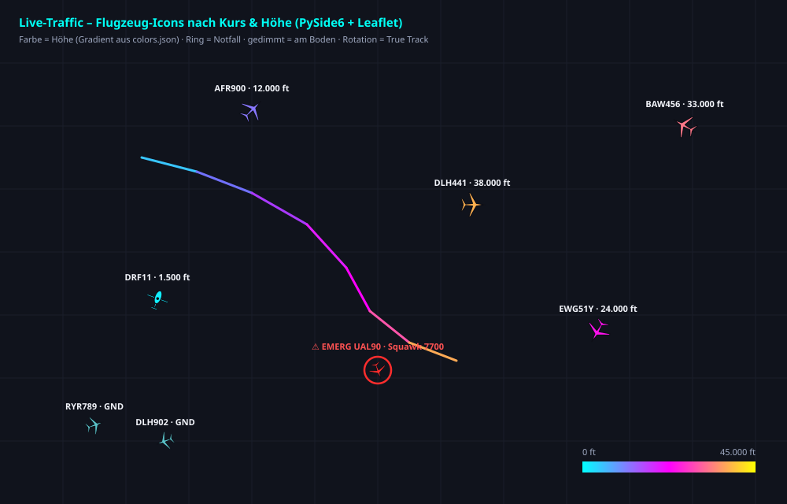

# MSFS Live Traffic Utility

[](https://www.python.org/)
[](https://doc.qt.io/qtforpython-6/)
[](LICENSE)

**Sprachen und Dokumentation:** [English](README.md) · [Vollständige Projektdokumentation (PDF)](Dokumentation/Projekt-Dokumentation.pdf)

Eine Echtzeitkarte für ADS-B-Verkehr mit optionaler KI-Verkehrsinjektion in Microsoft Flight Simulator über SimConnect. Fertig konfigurierte Clients verwenden standardmäßig den zentralen Community-Proxy mit automatischem Peer-Mesh-Failover. Endanwender müssen keinen eigenen Proxy einrichten.



## Inhaltsverzeichnis

- [Netzwerk und Ausfallsicherheit](#netzwerk-und-ausfallsicherheit)
- [Funktionen](#funktionen)
- [Geplante Funktionen und Roadmap](#geplante-funktionen-und-roadmap)
- [Voraussetzungen und Installation](#voraussetzungen-und-installation)
- [Schnellstart und GUI-Bedienung](#schnellstart-und-gui-bedienung)
- [Konfiguration](#konfiguration)
- [Eigenen Proxy betreiben (Open Source)](#eigenen-proxy-betreiben-open-source)
- [Architektur](#architektur)
- [Tests](#tests)
- [Datenquellen, Lizenz und Haftungsausschluss](#datenquellen-lizenz-und-haftungsausschluss)
- [Mitwirken](#mitwirken)

## Netzwerk und Ausfallsicherheit

Standardmäßig bezieht jeder Client den Verkehr über den zentralen Community-Proxy. Das verringert wiederholte Upstream-Abfragen und stellt eine gemeinsam genutzte, einstündige Flugspurhistorie sowie den Live-Servicestatus bereit. Die [öffentliche Statusseite](http://dnd.59-seconds.com/ltu/index.php) ist ohne Token erreichbar und zeigt Datenquellen, Regionen und Client-Verfügbarkeit. Sind die Collector-Daten veraltet oder melden mindestens die Hälfte der frischen Client-Heartbeats einen Proxy-Ausfall oder HTTP 429, wählt die Webseite – sofern verfügbar – einen geeigneten, funktionierenden Client als temporären Relay. Der gesamte Relay-Verkehr läuft über die Webseite; offene Ports oder Router-Konfiguration sind nicht nötig. Erst wenn dieses Web-Relay nicht verfügbar ist, fragt jeder Client die direkten APIs in dieser Reihenfolge ab: **adsb.lol → adsb.fi → OpenSky Network**. Sind alle direkten Quellen ausgefallen, kann der Client seinen letzten zwischengespeicherten Verkehr anzeigen.

## Funktionen

### Karte und Darstellung

- Dunkle Qt-Desktopoberfläche mit mehrseitigem Einstellungsdialog; umgesetzt mit PySide6, QtWebEngine, QtWebChannel und Leaflet.
- Live-Karte und Flugzeugtabelle. Suche nach Rufzeichen, ICAO-Hex, Typ oder Registrierung; zusätzliche Airline- und Typfilter sowie Mindesthöhe, Bodenverkehr, Beschriftungen und Folgen.
- Gedrehte SVG-Silhouetten für Verkehrsflugzeuge und Hubschrauber, höhenabhängige Farben, Abdunklung am Boden und Notfallmarkierung für Squawk 7500/7600/7700 oder ADS-B-Notfallstatus.
- Flugzeug auswählen, um Airline, Kategorie, Route, Navigationsdaten und weitere verfügbare Details zu sehen. Die Routensuche nutzt adsbdb und kann eine Großkreislinie sowie Start- und Zielflugplatzmarkierungen anzeigen.
- Inkrementelle, längenbegrenzte und höhenfarbige Flugspuren für das ausgewählte Flugzeug und den sichtbaren Verkehr. Der Proxy speichert Stichproben aus Collector-/Relay-Pushes und frischen Regionalantworten bis zu einer Stunde; Spuren lassen sich per Hex-Code oder Rufzeichen abrufen und beim Auswählen asynchron nachladen.
- Suche mit Kartensprung, Auswahl des nächstgelegenen Flugzeugs, Excel-freundlicher CSV-Export mit Semikolon sowie Notfall-Popups und -Signaltöne ohne doppelte Alarme.
- OpenStreetMap, dunkle CARTO-Karte, OpenTopoMap oder ein eigener Tile-Server. Eigene Tile-URLs müssen `{z}`, `{x}` und `{y}` enthalten und die erforderliche Attribution anzeigen.

### MSFS-Integration und TCAS

- Die Karte funktioniert auch ohne MSFS oder SimConnect. Die KI-Injektion startet standardmäßig automatisch, sobald ein Simulator erkannt wird; sie lässt sich unabhängig von der Verkehrskarte ein- und ausschalten.
- SimConnect liefert die Spielerposition für Folgen und TCAS. Das eigene Flugzeug erscheint auf der Karte; TCAS zentriert die Ansicht auf den Spieler und zeigt für ausgewählten Verkehr relative Peilung/Uhrposition, Entfernung, Höhendifferenz und Steig-/Sinktrend.
- Experimentelle KI-Verkehrsinjektion ordnet Live-Flügen kompatible lokale Flugzeugmodelle zu. FSLTL-Basismodelle werden empfohlen, sind aber nicht enthalten; Injektion und Modellzuordnung werden weiterentwickelt.
- Am Boden erzeugte Parkflugzeuge sind künstliche lokale Szenerie und keine Live-Flüge. Das Auffüllen ist bestmöglich: Es endet, wenn SimConnect eine Spawn-Anfrage ablehnt oder die Sicherheitsgrenze erreicht ist. Eine Ablehnung beweist nicht, dass alle Parkpositionen belegt sind.
- Standardmäßig maximal 50 Parkflugzeuge; als Standardmodell wird ein installiertes A20N-Modell verwendet. Erkennung des Community-Ordners und die ältere `aircraft.cfg`-Titelzuordnung werden weiter unten beschrieben.

### Ausfallsicherheit, Mesh und Bedienbarkeit

- Das Web-Relay-Peer-Mesh wählt bei Proxy-Ausfall oder Rate-Limit automatisch einen Client aus und bei dessen Ausfall den nächsten. Eingehende Ports sind nicht erforderlich.
- Statusanzeigen für Proxy, adsb.lol, adsb.fi, OpenSky, Mesh-Rolle und MSFS-Verbindung: Grün = funktionsfähig, Orange = HTTP 429, Rot = ausgefallen, Grau = inaktiv. Der öffentliche Servicestatus wird auch auf der Webkarte angezeigt.
- QSettings speichert Fenstergeometrie, Kartenposition/-stil, Filter, Darstellung, Netzwerk- und MSFS-Optionen. Der Einstellungsdialog kennzeichnet vorherige Standardwerte; **Standardeinstellungen laden** erhält gespeicherte Proxy-Zugangsdaten, Mesh-Namen und lokale Simulatorpfade.
- Der animierte Startbildschirm durchläuft reale Ladeschritte einschließlich des `aircraft.cfg`-Scans. Zeitgestempelte Protokolle unter `logs/` enthalten UI-Aktionen, Einstellungen, Quellenanfragen/-status sowie MSFS-/Mesh-Ereignisse. Ist das Programmverzeichnis nicht beschreibbar, wird ein Benutzer-Datenverzeichnis verwendet.
- Die Oberfläche erkennt Deutsch oder Englisch anhand der Betriebssystem-Locale. Die Logik in `traffic_core.py` ist unabhängig von Qt nutzbar und testbar.

## Geplante Funktionen und Roadmap

- PlaneTrack.ai ist als optionale vierte Datenquelle für eine zukünftige Version geplant und gehört nicht zur aktuell dokumentierten Drei-Quellen-Kette.
- Für MSFS-2024-SimObjects ist eine modulare Livery-Auflösung geplant. Die aktuelle Zuordnung nutzt ältere `aircraft.cfg`-Titel; SimConnect EX1 erhält den vollständigen Titel und ein leeres Livery-Feld, wodurch die Standard-Livery gewählt wird.

## Voraussetzungen und Installation

Für die fertig gepackte Anwendung ist **Windows 10/11** erforderlich. Der Kartenmodus kann aus dem Quellcode auch unter Linux oder macOS laufen. Bei Quellcodebetrieb werden Python 3.10+ und eine Internetverbindung benötigt. KI-Verkehrsinjektion setzt zusätzlich MSFS 2020 oder 2024, eine verwendbare SimConnect-DLL/-Verbindung und kompatible Flugzeugmodelle voraus. Für den reinen Kartenmodus ist SimConnect optional.

### Option A: Windows-Release (sofort einsatzbereit)

1. Das aktuelle ZIP von [GitHub Releases](https://github.com/PhW3130/MSFS-Live-Traffic-Utility-PUBLIC-BETA/releases) herunterladen.
2. Das Archiv in einen beschreibbaren Ordner entpacken.
3. `MSFS Live Traffic Utility.exe` starten. Das Release verwendet standardmäßig den Community-Proxy; eine Netzwerkkonfiguration ist nicht nötig.

### Option B: Aus dem Quellcode starten

```bash
git clone https://github.com/PhW3130/MSFS-Live-Traffic-Utility-PUBLIC-BETA.git
cd MSFS-Live-Traffic-Utility-PUBLIC-BETA
python -m pip install -r requirements.txt
python main.py
```

Für einen eigenständigen Windows-Build auf einem anderen PC (Python ist auf dem Ziel-PC nicht nötig) `build_exe.bat` ausführen. Das Paket liegt anschließend unter `dist/MSFS Live Traffic Utility/`. Ein gepushter `v*`-Tag startet den Windows-Release-Workflow und hängt `MSFS-Live-Traffic-Utility-win64.zip` an ein GitHub-Release an; Pull Requests prüfen den Windows-Build. Der vollständige Build und Betrieb des Proxy-Stacks ist in der [Anleitung zum Self-Hosting](docs/SELF_HOSTING_PROXY.md) (Englisch) und in der [deutschen Projektdokumentation (PDF)](Dokumentation/Projekt-Dokumentation.pdf) beschrieben.

## Schnellstart und GUI-Bedienung

- Die Live-Karte startet standardmäßig mit allen Flugzeugen. Eine Flugnummer eingeben und **Start** wählen, um einen Flug zu verfolgen; Eingabe löschen oder **All aircraft** wählen, um zur Gesamtansicht zurückzukehren.
- Flugzeug über das Kartensymbol oder die Tabellenzeile auswählen. `Esc` hebt die Auswahl auf; ein Doppelklick auf eine Zeile folgt dem Flugzeug und zoomt heran.
- Mit `+` und `-` zoomen. Ein Rechtsklick auf die Karte wählt das nächstgelegene Flugzeug aus.
- Die Suche filtert Karte und Tabelle während der Eingabe. `Enter` wählt den ersten Treffer aus und springt dorthin. Die Werkzeugleiste bietet außerdem Airline-/Typfilter, Spuren aller Flugzeuge, **TCAS (MSFS)**, Notfallmeldungen und CSV-Export.
- Bei erkannter MSFS-Verbindung **MSFS AI traffic** ein- oder ausschalten, ohne die Live-Karte anzuhalten. Startet die Anwendung vor MSFS, wird die SimConnect-Verbindung automatisch erneut geprüft.
- Unter **Settings** Kartenstil, Darstellung, Filter, Netzwerk und Simulatoroptionen einstellen. Änderungen werden soweit möglich sofort übernommen; ein Wechsel des Community-Ordners oder der SimConnect-DLL erfordert einen Neustart.

Die Anwendung durchsucht `UserCfg.opt`-Dateien nach MSFS-Community-Ordnern. Werden mehrere Installationen gefunden, kann eine ausgewählt werden; ohne Treffer lässt sich der Community- oder übergeordnete Packages-Ordner manuell wählen. `aircraft.cfg`-Titel des ausgewählten Ordners werden für die KI-Modellzuordnung indiziert. Die aktuelle FSLTL/VMR-Zuordnung verwendet ältere Flugzeugtitel; die modulare Livery-Auswahl von MSFS 2024 ist noch nicht implementiert.

Befindet sich der Spieler am Boden, ermittelt die Parkflugzeug-Funktion den Flugplatz zuerst über `MSFS_AIRPORT_ICAO`, dann über aktuelle SimConnect-Flugplatz-SimVars und zuletzt anhand des Live-Verkehrs. SimConnect liefert keine verlässliche Zahl freier Parkpositionen; das Auffüllen bleibt daher bestmöglich.

## Konfiguration

Per-User-QSettings speichert Kartenmittelpunkt/Zoom/Stil, eigene Tiles, Theme- und Höhenfarbverlauf, Icon-Größen, Verkehrsfilter, Aktualisierungsintervall sowie Proxy-/Mesh- und MSFS-Optionen. `colors.json` enthält Entwickler-/Distributoren-Standardwerte für UI-, Label-, Notfall- und Akzentfarben, Höhenfarbverlauf, Flugzeugsymbole, Karte, Proxy und Peer-Mesh. **Standardeinstellungen laden** erhält gespeicherte Proxy-Zugangsdaten, Mesh-Namen und lokale MSFS-Pfade.

- Priorität der Proxy-URL: `LTU_PROXY_URL` → gespeicherte Benutzereinstellung → `page.txt` → `colors.json`-Wert `proxy.url`. `page.txt` ist gitignored und kann neben Quellskript oder gepackter EXE liegen; maßgeblich ist die erste Nicht-Kommentarzeile. `page.example.txt` ist eine Vorlage.
- `LTU_PROXY_TOKEN` überschreibt das gespeicherte Proxy-Token. Fertige Builds sind für den Community-Proxy vorkonfiguriert; eigene Proxys werden in der Self-Hosting-Anleitung beschrieben.
- `LTU_MESH=off` deaktiviert das Peer-Mesh. Aktivierung und optionaler Anzeigename stehen außerdem in `colors.json` unter `peer_net` oder in den Benutzereinstellungen.
- `MSFS_COMMUNITY_PATH` überschreibt die Erkennung des Community-Ordners; `MSFS_PACKAGES_PATH` kann einen Packages-Ordner angeben. `MSFS_SIMCONNECT_DLL` wählt eine lokale SimConnect-DLL.
- `MSFS_AIRPORT_ICAO` überschreibt die Parkflugzeug-Flugplatzerkennung. `MSFS_MAX_PARKED_FILLERS` setzt die Obergrenze (Standard `50`); `MSFS_PARKED_FILLER_MODEL` überschreibt das installierte A20N-Standardmodell.
- Eigene Karten-Tile-URLs müssen `{z}`, `{x}` und `{y}` enthalten sowie die korrekte Attribution anzeigen.

## Eigenen Proxy betreiben (Open Source)

Der vollständige Stack – Qt-Desktopclient, PHP-Webrelay und C++-Collector – ist Open Source und kann für eine Gruppe oder eine unabhängige Bereitstellung auf eigener Infrastruktur betrieben werden. Die [englische Detailanleitung](docs/SELF_HOSTING_PROXY.md) beschreibt `rea/`, Collector-/PHP-Setup, OpenSky-Zugangsdaten und Kontingente, Watchdog, Admin-Konsole, Statusseite und Web-Relay-Mesh. Die entsprechende ausführliche deutschsprachige Dokumentation steht in der [PDF-Projektdokumentation](Dokumentation/Projekt-Dokumentation.pdf).

## Architektur

| Modul | Aufgabe |
|---|---|
| `main.py` | PySide6-Hauptfenster, Werkzeugleiste, Flugzeugtabelle, Detailbereich, QWebEngineView und Qt-Bridge. |
| `settings_dialog.py` | Mehrseitiger Einstellungsdialog; `MainWindow` übernimmt und speichert Einstellungen. |
| `traffic_core.py` | UI-unabhängige ADS-B-Logik: Abfragen, Filter, Suche, Auswahl, Spuren, Routen und Zustands-Snapshots. |
| `msfs_ai.py` | SimConnect-Spielerposition, Flugzeug-Spawns, Parkflugzeuge und KI-Verkehrs-Thread. |
| `startup_splash.py` | Animierter Startbildschirm und Anzeige der Ladestufen. |
| `aircraft_config.py` | Erkennung des MSFS-Community-Ordners und Katalog der `aircraft.cfg`-Titel. |
| `gui_web/` | Leaflet-Karte, Flugzeug-SVGs und JavaScript-Oberfläche in QtWebEngine. |
| `model_map.py`, `modelmap.txt` | Flugzeug-zu-Modell-Zuordnungsregeln und Titelkatalog. |
| `routes.py` | adsbdb-Routenabfrage und Flugplatznähe-Hilfsfunktionen. |
| `peer_net.py` | Client-Heartbeat, serverseitig gewähltes Peer-Relay, Failover und Mesh-Status. |
| `proxy/` | Optionaler PHP-Relay (`index.php`, `client_demand.php`, `aircraft_tracks.php`) und C++-Collector (`ltu_collector.cpp`). |

Python übergibt Kartenstatus über Qt-Signale (`stateUpdated`, `settingsUpdated`) an JavaScript. JavaScript ruft Python-Slots am `bridge`-Objekt auf (`aircraftClicked`, `mapContextMenu`, `mapMoved`, `uiReady`).

## Tests

Die Headless-Tests benötigen weder Display noch laufenden Simulator oder Qt-Bibliotheken. Bei Bedarf zusätzlich zu `requirements.txt` `pytest` und `requests` installieren.

```bash
python -m py_compile main.py settings_dialog.py startup_splash.py aircraft_config.py traffic_core.py routes.py msfs_ai.py model_map.py peer_net.py
python tests/test_traffic_core.py
python tests/test_aircraft_history.py
python tests/test_peer_net.py
python tests/test_msfs_ai.py
python tests/mock_qt_test.py
python -m pytest -q tests/test_aircraft_config.py tests/test_model_map.py
```

C++-Hilfstests mit einem C++11-Compiler bauen und ausführen:

```bash
for test in opensky_auth client_demand adsb_sources collector_reliability; do
  g++ -std=c++11 -Wall -Wextra -pedantic "tests/test_${test}.cpp" -o "/tmp/test_${test}" && "/tmp/test_${test}"
done
```

PHP-Syntaxprüfungen und Proxy-Tests mit PHP 8.2 oder neuer ausführen:

```bash
for file in proxy/index.php proxy/client_demand.php proxy/aircraft_tracks.php; do php -l "$file"; done
php tests/test_client_demand.php
php tests/test_opensky_proxy.php
php tests/test_aircraft_tracks.php
```

GitHub Actions führt Python-, PHP-, C++- und Qt-Wiring-Tests bei Pushes und Pull Requests aus. Der Windows-Distributionsworkflow prüft zusätzlich den Collector-Build.

## Datenquellen, Lizenz und Haftungsausschluss

Die Anwendung verwendet derzeit ausschließlich diese drei ADS-B-Datenquellen:

- **adsb.lol** — kostenlose Regionalabfragen über `/v2/lat/{lat}/lon/{lon}/dist/{dist}`. Der Betreiber beschreibt dynamische, lastabhängige Limits statt eines festen Kontingents. Die [API-Dokumentation](https://github.com/adsblol/api) erläutert Routen und Antworten; 4xx-Antworten weisen auf fehlerhafte Anfragen hin, eine API-Key-Pflicht könnte künftig eingeführt werden.
- **adsb.fi Open Data** — regionaler Fallback über die offizielle v3-Route `/api/v3/lat/{lat}/lon/{lon}/dist/{dist}` (Entfernung in nautischen Meilen, höchstens 250 NM). Öffentliche Anfragen sind auf eine pro Sekunde begrenzt; der Dienst ist für persönliche, nicht-kommerzielle Nutzung mit Quellenangabe vorgesehen. Siehe [API-Dokumentation](https://github.com/adsbfi/opendata).
- **OpenSky Network** — OAuth2-Zugangsdaten werden ausschließlich vom Collector verwendet; der direkte Client-Fallback ist anonym und rate-limitiert. Die Live-API ist laut OpenSky für Forschung und nicht-kommerzielle Nutzung vorgesehen. Siehe [REST-API-Dokumentation](https://openskynetwork.github.io/opensky-api/rest.html).

Es sind keine kostenpflichtigen Luftfahrtdaten-Feeds wie ADS-B Exchange oder FlightAware integriert. Provider-Kontingente, Nutzungsbedingungen und regionale Verfügbarkeit sind einzuhalten; die Anwendung darf nicht zum Umgehen solcher Grenzen verwendet werden. OpenSky-Collector-Konfiguration und persistentes Kontingent-Ledger sind in der [Projektdokumentation (PDF)](Dokumentation/Projekt-Dokumentation.pdf) beschrieben. Der anonyme OpenSky-Fallback des Desktopclients ist auf 250 km Radius und höchstens eine Abfrage je Prozess in 15 Minuten begrenzt (bis zu 96 Abfragen bzw. 384 Credits pro 24 Stunden bei vier Credits je Anfrage). Der Timer wird beim Neustart zurückgesetzt und koordiniert keine weiteren Nutzer hinter derselben öffentlichen IP.

Leaflet 1.9.4 steht unter BSD-2-Clause; der Lizenztext liegt unter [`gui_web/leaflet/LICENSE`](gui_web/leaflet/LICENSE). OpenStreetMap-Kacheln nennen © OpenStreetMap-Mitwirkende ([Copyright](https://www.openstreetmap.org/copyright)); CARTO-Kacheln nennen © OpenStreetMap-Mitwirkende und © CARTO ([Attribution](https://carto.com/attributions)); OpenTopoMap verwendet OpenStreetMap-/SRTM-Daten und der Kartenstil steht unter [CC-BY-SA 3.0](https://creativecommons.org/licenses/by-sa/3.0/). Die Nutzungsbedingungen und Attribution des Tile-Anbieters sind einzuhalten. Drittanbieter-Assets, Daten und Dienste bleiben ihren eigenen Lizenzen unterworfen; siehe [`THIRD_PARTY_NOTICES.txt`](THIRD_PARTY_NOTICES.txt) und die [Veröffentlichungs-Checkliste](docs/PUBLISHING-CHECKLIST.md). FSLTL-Flugzeugmodelle sind nicht enthalten.

Copyright (C) 2026 PhW3130. Projektcode darf unter der **GNU Affero General Public License Version 3.0 only (AGPL-3.0-only)** verwendet, geändert und weitergegeben werden; siehe [`LICENSE`](LICENSE). Wenn eine geänderte Version Nutzern über ein Netzwerk bereitgestellt wird, verpflichtet Abschnitt 13 der AGPLv3 dazu, diesen Nutzern den entsprechenden Quellcode anzubieten. Für frühere Kopien ändert diese Lizenzangabe nichts.

**Haftungsausschluss:** Dieses Projekt steht in keiner Verbindung zu Microsoft, Asobo Studio, Flightsim.to, FSLTL, ADS-B Exchange, adsb.lol oder anderen Drittorganisationen und wird von diesen nicht unterstützt. Microsoft Flight Simulator und zugehörige Marken gehören ihren jeweiligen Inhabern. Die Anwendung dient ausschließlich Flugsimulation und Information; sie ist kein Navigations-, Dispositions- oder Flugsicherungswerkzeug. Sie wird ohne Gewährleistung und vorbehaltlich der jeweils geltenden Lizenz- und Drittanbieterbedingungen bereitgestellt.

## Mitwirken

Das Projekt wird aktiv entwickelt und bleibt experimentell, insbesondere KI-Verkehrsinjektion und Flugzeugmodell-Zuordnung. Beiträge, Fehlerberichte, Aktualisierungen der Flugzeugzuordnungen, Release-Tests und Funktionsvorschläge sind willkommen. Bitte Issues oder Pull Requests im [GitHub-Repository](https://github.com/PhW3130/MSFS-Live-Traffic-Utility-PUBLIC-BETA) öffnen. Vor einer Weitergabe des Pakets die [Veröffentlichungs-Checkliste](docs/PUBLISHING-CHECKLIST.md) prüfen und die Rechte für alle gebündelten Drittanbieter-Materialien dokumentieren.
